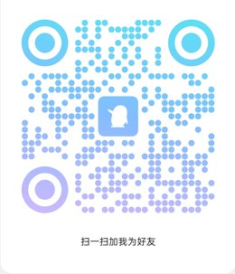

# LIS / LIMS Selection Guide for Small & Mid-Size Laboratories (2026)

<b>LIS / LIMS source-code licence · custom development · single &amp; bidirectional instrument interfaces (ASTM / HL7 v2) · Xinchuang-ready build · regional laboratory networks · third-party lab LIMS · open to any form of partnership</b>

<b>Email: 2536811576@qq.com　｜　WeChat: dynn2018　｜　QQ: 2536811576</b>

---

> A practical buyer's guide to choosing a **Laboratory Information System** — for private labs, small hospital labs, public-health lab networks, EHR vendors who need a lab module, and instrument distributors.
> Covers the US (CLIA / CAP / HIPAA), the EU & UK (GDPR / IVDR / UKAS), and the ISO 15189 world (70+ countries), plus the interoperability stack — LOINC, HL7 v2, FHIR R4, ASTM — that actually decides whether a system will work.
>
> **Last reviewed: 2026-11-18.** Reviewed quarterly against official sources.
>
> **Disclosure:** This is not an official document. The author provides LIS deployment, source-code licensing and white-label services, and therefore has a commercial interest. Every regulatory statement below links to the issuing body; anything that is a third-party figure or a vendor claim is labelled as such. Verify against the current official text before making a procurement or compliance decision.

If you take one thing from this guide: **outside the US, the buying criterion is usually not features — it is whether the system can produce evidence an assessor will accept, and whether it can exchange coded results with the systems around it.** A feature list will not answer either question.

---

## 1. Start with the problem, not the software

Before comparing vendors, write down which of these you are actually solving. They lead to very different purchases.

| Your situation | What actually matters | What to skip |
|---|---|---|
| Replacing paper / spreadsheets, first LIS | Barcode accessioning, instrument result capture, a printable report, backup | Multi-site, biobank, advanced analytics |
| Outgrowing a spreadsheet but failing inspections | Audit trail, QC records, corrected-report history, competency logs | Anything marketed as "AI-powered" |
| Accreditation or re-accreditation coming up | The evidence pack an assessor asks to see (§7) | Demo polish |
| Results are not reaching the EHR cleanly | LOINC mapping, HL7 v2 / FHIR conformance, unit and flag alignment (§5) | More report templates |
| Public-health / NGO lab network, unreliable connectivity | Offline-first, self-hosting, low-bandwidth sync (§9) | Cloud-only SaaS |
| EHR vendor with no lab module | White-label / source licence, documented API, exit terms (§6, §16) | Building from scratch |
| Instrument distributor asked "which system comes with it" | A partner who carries delivery and support (§16) | A vendor that will sell to your customer directly |

> A system that looks impressive in a demo but cannot export your data in a standard format is a liability, not an asset. **Ask about the exit before you ask about the features.**

---

## 2. A terminology trap that costs real money in English

**"LIS" is not a safe acronym in English-language search.** In different countries it means entirely different things:

| Search | What it actually returns |
|---|---|
| `LIS Philippines` | The Department of Education's **Learner Information System** |
| `LIS Nigeria` | Often resolves to **LIRS**, the Lagos State tax authority |
| `LIS Indonesia` | Commonly **logistics information systems** |
| `LIS implementation` | Frequently mixed with unrelated library / IT service topics |
| `open source LIS` | Much thinner results than **`open source LIMS`** |

For procurement documents, RFPs, and vendor discovery, use the unambiguous terms:

- **Laboratory Information System** (clinical, patient-centric) — often abbreviated **LIS**
- **Laboratory Information Management System** (sample-, batch- and process-centric) — **LIMS**
- **`lims for small labs`**, **`laboratory information system for small hospitals`**, **`open source LIMS`**, **`how much does a LIMS system cost`** — the phrases buyers actually search

**LIS vs LIMS is a real distinction abroad**, not a marketing nuance:

| | Clinical LIS | LIMS |
|---|---|---|
| Organising unit | The **patient / specimen / order** | The **sample / batch / request** |
| Typical setting | Hospital lab, private clinical lab, public-health lab | Environmental, food, pharma, materials, research, biobank |
| Governing standards | CLIA, CAP, ISO 15189, HIPAA, LOINC, HL7/FHIR | ISO/IEC 17025, GLP/GMP, 21 CFR Part 11 |
| Data model | Orders → specimens → results → reports | Samples → aliquots → tests → results → CoA |

Many industrial LIMS products are **not** suitable for clinical reporting, and most clinical LIS products are poor at batch/sample management. If a vendor uses both words interchangeably, that is your first signal to dig deeper.

> Full comparison: [LIS vs LIMS, and why the acronym matters](docs/terminology-lis-vs-lims.md)

---

## 3. Three regulatory worlds, not one

This is the single biggest difference between buying a LIS in different markets. **There is no global "LIS certification".** What exists is a set of obligations on the *laboratory*, and a set of capabilities the *software* must provide so the laboratory can meet them.

> **A LIS is never "ISO 15189 certified", "CLIA certified", "CAP accredited" or "HIPAA certified".** Accreditation and certification attach to laboratories, not to software. A vendor page claiming otherwise is describing a regime it does not understand — see [Red flags](#14-red-flags). This is the fastest way to disqualify a supplier in a technical evaluation.

### 3.1 United States — CLIA is the floor, CAP is the ceiling

| Layer | What it is | What it means for the LIS |
|---|---|---|
| **CLIA '88** (42 CFR Part 493) | Mandatory federal certification administered by CMS, with FDA and CDC. Any lab testing human specimens for diagnosis, prevention or treatment must hold a CLIA certificate. Five certificate types: Waiver, Provider-Performed Microscopy, Registration, Compliance, Accreditation. | The certificate type determines which test menus, personnel-qualification records, QC frequencies and retention rules the system must track. **Ask which certificate type the lab holds before configuring anything.** |
| **CAP Laboratory Accreditation Program** | Peer-inspection accreditation against 21 discipline-specific checklists (3,000+ standards), on-site inspection every two years with a self-inspection in the off year. Holds **deemed status** under CLIA. | Inspectors ask to see records in the room: audit trail, QC, PT, competency, SOP control (§7). |
| **COLA / The Joint Commission** | Other CMS-approved deemed-status organisations; COLA is common for physician-office and small labs. | Similar record requirements, lighter administrative burden. |
| **HIPAA / HITECH** | Privacy, Security and Breach Notification Rules for protected health information. | Role-based access, unique user IDs, automatic logoff, audit controls, encryption in transit and at rest, a **Business Associate Agreement (BAA)** with any hosted vendor, documented breach response. |
| **21 CFR Part 11** | FDA rules on electronic records and electronic signatures. | Tamper-evident audit trails, e-signature at result release, version history, no ability to overwrite a released result. |
| **State law** | Record retention is often stricter than the federal floor. | Configurable retention by jurisdiction. |

Two 2025–2026 developments worth knowing:
- CMS moved to **electronic-only CLIA notifications**, with full enforcement from **1 March 2026**; labs must maintain monitored compliance mailboxes and keep LIS report templates current.
- The FDA's 2024 rule to regulate laboratory-developed tests as devices was **rescinded on 19 September 2025** following a court vacatur; **CLIA remains the operative federal framework**. Do not let a vendor sell you "FDA-ready" as a substitute for CLIA work.

### 3.2 European Union & United Kingdom

| Layer | What it is | What it means for the LIS |
|---|---|---|
| **UKAS ISO 15189** | The UK's sole national accreditation body; ISO 15189 accreditation is a requirement for NHS pathology laboratories. | Same evidence pack as §7; scope is examination-specific and published in a public register. |
| **GDPR** | Personal-data regulation; health data is a special category. | Lawful basis, data minimisation, access/erasure rights, DPIA, processor agreements, **data-residency and transfer controls**. |
| **IVDR 2017/746 / MDR** | Rules for in-vitro diagnostic devices and medical devices. | **Important nuance:** under MDCG qualification guidance, a LIS that only stores, organises and presents data is **neither an IVD nor a medical device**. Software that *interprets raw measurement data* (e.g. ELISA optical density, blot patterns) to produce a diagnostic finding generally **is** IVD software. Ask where the vendor's product sits on that line. |
| **EHDS / national programmes** | European Health Data Space and national digital-health infrastructure (e.g. Australia's My Health Record, see below). | FHIR-based exchange, national identifier support, patient-facing portals. |

### 3.3 The ISO 15189 world — 70+ countries, and it is often mandatory

**ISO 15189:2022 is the international standard for medical laboratories, adopted by accreditation bodies in more than 70 countries.** It is built on ISO/IEC 17025 and ISO 9001 principles, uses a risk-based approach, and the 2022 edition **strengthened requirements for information management and laboratory information systems**. Accreditation bodies are peers under the ILAC Mutual Recognition Arrangement — since **1 January 2026** the arrangement operates under **Global ACI**, which merged ILAC and IAF; legacy accreditations remain recognised through the transition.

Country examples that matter if you sell or buy outside the US:

| Country | Who accredits | Why it is commercially relevant |
|---|---|---|
| Australia | **NATA** / RCPA | NATA accreditation to ISO 15189 is a prerequisite for Approved Pathology Laboratory status and Medicare reimbursement. |
| New Zealand | **IANZ** | Accreditation based on ISO 15189 is required by the Health and Disability Services (Safety) Act 2001 for public and private diagnostic labs. |
| United Kingdom | **UKAS** | Required for NHS pathology laboratories. |
| India | **NABL** (QCI) | ISO 15189 accreditation is tied to PM-JAY empanelment and government reimbursement tiers. |
| Vietnam | Ministry of Health | Circular 24/2017/TT-BYT sets a quality roadmap; the highest laboratory grades require ISO 15189. |
| Singapore | **SAC-SINGLAS** or CAP | Recognised pathways under the Healthcare Services Act licensing framework. |
| Philippines | PhilHealth | Circular 2021-0001 ties international accreditation to "Center of Excellence" status and contracting tiers. |
| Malaysia | **SAMM** / FOMEMA | MS ISO 15189 accreditation is required for FOMEMA panel laboratories. |
| United States | **A2LA**, CAP | Both offer ISO 15189-based programmes; CAP also offers it alongside its own checklist programme. |

For public-health, HIV, TB and reference-lab networks in low- and middle-income countries, also expect **WHO / SLIPTA**-style stepwise quality frameworks, and donor reporting requirements. This is the segment where open-source clinical LIS projects have the strongest installed base.

> Detailed, source-linked comparison: [Regulatory map — US, EU/UK, and the ISO 15189 world](docs/regulatory-map.md)

---

## 4. What an assessor can actually check

Accreditation is scope-specific. Before accepting any supplier's claim, verify it against the **accrediting body's public register**, check that the examinations you need are in the published scope, and confirm the certificate has not lapsed or been suspended. A PDF certificate supplied by the vendor is not evidence.

For a LIS, the recurring evidence items are:

- Chain of custody: every specimen state change with timestamp and operator
- Result bound to method, instrument, reagent lot and operator
- Internal QC with out-of-control handling and corrective action records
- External quality assessment / proficiency testing enrolment and evaluation
- **Corrected reports preserving the original value, author, time and reason**
- Critical-value notification with time, recipient and read-back
- Role-based permissions, and a record of who could change what
- Competency and training records with expiry alerts
- Version-controlled SOPs with approval workflow
- Backup, restore testing, and downtime / business-continuity records

> ISO 15189:2022 places these under information management, record control, and pre-/post-examination process requirements; CAP inspectors ask for the same artefacts in the room. See the [Inspector evidence checklist](docs/inspector-evidence-checklist.md).

---

## 5. Interoperability is the real buying criterion abroad

Most LIS projects do not fail because a feature is missing. **They fail because integration is underestimated.** Every analyser model has its own protocol, and field-level mapping between the LIS and the EHR is where errors hide.

| Standard | Role | What to demand in the RFP |
|---|---|---|
| **LOINC** | International terminology for identifying tests and observations (112,405 codes; maintained by Regenstrief; v2.83 current). A LOINC Fully-Specified Name has six parts: Component, Property, Timing, System, Scale, Method. | A **local-code → LOINC mapping table** you can export and version-control, and dual coding (HL7 v2 and FHIR both allow local + LOINC). |
| **HL7 v2.x** | The dominant transport for clinical orders/results in the US. **ORM / OML** carry orders out; **ORU** carries results back. | Conformance statement for the exact version (e.g. v2.4.1 ORM as a minimum in some national profiles), sample messages, and a field-mapping document covering test codes, specimen source, units and abnormal flags. |
| **FHIR R4** | API-based exchange. **ServiceRequest** = order, **Observation** = individual result, **DiagnosticReport** = grouped report. **US Core** profiles add mandatory status, LAB category, LOINC test code, patient reference, effective/issued time. | A working sandbox, capability statement, and whether DiagnosticReport/Observation are actually implemented (not just "FHIR-ready" on a slide). |
| **ASTM E1381 / E1394** | Lower-layer instrument communication; many analysers still use serial or TCP/IP ASTM, or flat files in a shared folder. | Bidirectional worklist/result support for **your exact analyser models**, plus a fallback for instruments that only emit files. |
| **SNOMED CT / ICD-10/11 / CPT / DICOM** | Qualitative result coding, diagnosis coding, US procedure/billing codes, imaging for histology. | Which are supported natively, and which require an integration. |
| **National profiles** | e.g. Australia's **AUCDI R2**, **SPIA**, **SNOMED CT-AU**, **IHI / HPI-O / HPI-I** identifiers, My Health Record upload, **Essential 8** cyber controls. | Written confirmation for the specific country — "FHIR compliant" is not a country-specific answer. |

Three questions that expose weak vendors immediately:

1. "Show me the **LOINC mapping table** for our top 50 tests, as a file I can keep."
2. "Show me a raw **ORU message** from one of our analysers and how it lands in the EHR."
3. "If we leave in three years, what do you give us, in what format, and does it include the code mappings?"

> Printable acceptance checklist: [Interoperability checklist — LOINC, HL7 v2, FHIR R4, ASTM](docs/interoperability-checklist.md)

---

## 6. Five ways to get a LIS (with the trade-offs that actually bite)

| | Commercial SaaS LIS | Enterprise suite | Open-source LIS | White-label / source licence | Build it yourself |
|---|---|---|---|---|---|
| Typical first-year cost (USD) | $12k–40k+ (subscription) | $30k–150k+ | $0 licence, **$28k–70k real cost** (see §8) | Negotiated | $150k+ and 12–24 months |
| Time to go-live | 4–12 weeks | 6–12 months | 2–6 months (+ validation) | 2–4 months | 12–24 months |
| Data location | Vendor cloud | Vendor cloud or on-prem | **Yours** | **Yours** | Yours |
| Validation burden | Vendor provides some | Vendor validation package | **Entirely yours** | Shared, contractually | Entirely yours |
| BAA / DPA | Must sign a BAA | Must sign a BAA | You are the covered entity | Depends on deployment | You are |
| Customisation | Limited, vendor PS | Expensive professional services | Full, but you maintain it | Full | Full |
| Exit / lock-in | **Highest risk** | High | Low (you hold the data) | **Lowest, if contracted well** | Low |
| Best for | Single-site private lab, US | Tertiary / multi-site networks | Lab with real in-house IT; public-health networks | EHR vendors, distributors, regional integrators | Only if the software *is* your product |

**On buying source code:** a source licence only pays off if you can maintain it. A useful screening question is "walk me through how your team packages and deploys a Spring Boot service" — if that cannot be answered, a white-label or revenue-share arrangement will serve both sides better than a source dump that turns into a failed implementation.

**Six things to put in a source-licence or white-label agreement:**
1. Full source vs "open core + closed modules" — list exactly what is closed
2. Licence and obligations (AGPL/GPL/MPL differ substantially — see §10)
3. Delivery inventory: source, DB scripts, deployment docs, interface docs, build instructions
4. Rebranding rights, and whether you may redistribute
5. Upgrade policy: how many major versions, at what cost
6. **Escape clause**: source escrow, or the right to obtain full source if the vendor stops maintaining it

---

## 7. What inspectors ask to see on every visit

An inspector does not ask whether your lab has good intentions. They ask to see the record, in the room. Six categories come up repeatedly in CAP-style inspections and map closely onto ISO 15189 evidence:

| # | Record | What the system must produce |
|---|---|---|
| 1 | **Tamper-evident audit trail** | Who changed a result, the before and after value, and when — at single-field level |
| 2 | **Electronic signatures** | Sign-off at result release, aligned to 21 CFR Part 11 |
| 3 | **QC** | Westgard multi-rule evaluation with Levey–Jennings charts; out-of-range results flagged **before** release |
| 4 | **Proficiency testing** | PT sample flagging, submission deadlines, result history in one view |
| 5 | **Competency** | Personnel qualification and training logs with expiry alerts |
| 6 | **SOP control** | Version-controlled procedures with approval workflow — not a shared drive with `final_v3` |

Plus the corrected-report and critical-value records in §4. A demo that cannot produce these on demand is not ready for an accredited lab.

---

## 8. What it actually costs (USD)

> Indicative ranges compiled from publicly listed prices and third-party published estimates in 2026. **Not a quote, not a promise.** Where a figure comes from a vendor or a third-party calculator, it is marked. Your cost depends on site count, analyser models, interface count, validation scope and on-site time.

| Line item | Indicative range | Note |
|---|---|---|
| SaaS LIS subscription | $500–3,000+/month | One published benchmark: **$999/month** for an unlimited-user hosted tier (vendor-published, Nov 2026, not independently verified) |
| Enterprise LIS, year one | $30,000–150,000+ | Often quoted by module; interfaces and validation extra |
| Per-analyser interface | $1,500–8,000 | Common models cheaper, rare/proprietary protocols much more |
| EHR / FHIR integration | $5,000–30,000 | Depends on the counterparty's cooperation |
| Implementation & training | $800–2,000/person-day | On-site vs remote |
| Annual maintenance | 15–20% of contract value | Below 10% usually means reduced service |
| CLIA certificate | $150–8,000 biennially | Varies by certificate type and volume (publicly cited range) |
| Validation documentation (URS→IQ/OQ/PQ) | $10,000–50,000+ | Commonly underestimated; see below |

**"Free" open source is the most misunderstood line.** One third-party 2026 calculation puts a self-hosted open-source LIS at roughly **$17,500–34,000/year ongoing**, and **$27,800–69,800 in year one** — almost all of it staff time for hosting, patching, backups, interface building, and HIPAA Security Rule work (third-party published estimate, based on list prices and BLS wage data, **not independently verified**). The licence is free; validation, integration and operations are not.

**Where the money actually goes:** not the software, but **interfaces and validation**. A $30k LIS reaching $70k after interfaces, validation and training is normal. Negotiating those two lines is more effective than shaving the licence fee.

> Worksheet: [Total cost of ownership worksheet (USD)](docs/tco-worksheet.md)
>
> Ranges answer "roughly how much". They do not answer "why is this bid three times that one". For that, see [Why two laboratory information system quotes are never comparable](docs/lis-quote-comparison.md) — a normalisation procedure to run before you negotiate.

---

## 9. Deployment realities in low-resource settings

This is where guides written for US hospitals quietly fail. If you operate where connectivity, power or local IT capacity is unreliable, the decision criteria change:

- **Offline-first is a requirement, not a feature.** A 24/7 lab needs a downtime mode — local cache or paper workflow with a defined manual-report numbering rule and a fixed deadline for back-entering results — so specimens keep moving when the server does not.
- **Self-hosting beats cloud-only** when cross-border data transfer is restricted or connectivity is intermittent. Docker-based single-command deployment is genuinely valuable here.
- **Localisation**: interface language, date/number formats, local report layout, and local regulatory identifiers. An English-only UI is a real adoption barrier.
- **Time zone and support**: "9–5 US Eastern email support" is not a support model for a lab in Southeast Asia or West Africa. Ask who responds, in which hours, in which language.
- **Hardware tolerance**: low-spec servers, unreliable power, no static IP. Ask what the minimum viable footprint is.
- **Donor / programme reporting**: public-health networks often need indicator exports for PEPFAR, Global Fund, or national programmes — a reporting requirement that no generic feature list covers.

> See [Offline & low-resource deployment](docs/offline-low-resource-deployment.md).

---

## 10. The open-source landscape — an honest comparison

We have a commercial interest, so here is the field as plainly as we can state it. **Verify every project's current release and licence against its own repository before committing** — activity changes.

| Project | Licence | Stack / shape | Strongest fit | Honest limitations |
|---|---|---|---|---|
| **OpenELIS Global** | MPL-2.0 | Java, Docker, **FHIR R4 native**, ASTM / HL7 / CSV analyser integration | **Public-health and clinical-network labs at national scale**; 1,000+ labs in 25+ countries claimed; supports ISO and SLIPTA-style requirements (project/vendor-published figures, not independently verified) | Built for laboratory networks, not a single small private lab; running it at scale needs IT staff and planning; v3.3.0 released Oct 2026 |
| **SENAITE** | GPLv2 | Python / Plone, modular | General analytical, research and testing labs; ISO/IEC 17025-oriented workflows | `senaite.health` (the clinical extension) was **archived in January 2024** — verify current clinical capability before assuming it |
| **Bika LIMS / Ingwe** | GPL | Plone → Ingwe (Bika 4) is Docker-based on the SENAITE core | Analytical / environmental / food testing | Active development has largely moved to the SENAITE fork; not a clinical-reporting-first system |
| **C4G BLIS** | open source | Basic clinical lab information system | Very small labs, resource-limited settings | Narrow scope; check current maintenance |
| **GNU Health Occhiolino** | GPL | Lab module inside GNU Health | Integrated public-health / hospital deployments | Requires the wider GNU Health stack |
| **Vibe Tox** | GPL-3.0-only | Desktop, offline, single machine | Small US toxicology labs | In development, tested on synthetic data, **not clinically validated** (as of Nov 2026) |
| **eLabFTW / OpenSpecimen** | AGPLv3 / BSD-3 | ELN / biobank | Research notebook, biobanking | **Not clinical LIS** — do not confuse with diagnostic reporting |

**Licence obligations matter if you plan to redistribute:** MPL-2.0 is file-level copyleft; GPL requires source release for distributed derivatives; **AGPL additionally triggers on network use** (a modified AGPL system offered as a service must offer its source to remote users). "Open source" does not automatically mean "you can close it and sell it".

> Full table with verification checklist: [Open-source LIS landscape](docs/open-source-lis-landscape.md)

---

## 11. RFP / vendor scorecard (100 points)

Do not score a demo. Score evidence. Weights below reflect what actually fails in accredited and networked deployments.

| Dimension | Points | What to ask for |
|---|---|---|
| Interoperability evidence | 20 | LOINC mapping export, sample ORU/ORM messages, FHIR conformance statement, instrument list |
| Audit trail & records | 20 | Field-level before/after trail, corrected-report history, e-signature, critical-value log |
| QC & EQA | 12 | Westgard rules, L-J charts, out-of-control workflow, PT tracking |
| Regulatory fit | 15 | Written mapping to **your** regime (§3), with the exact certificate type / accreditation body named |
| Deployment & resilience | 10 | On-prem option, offline mode, backup/restore test evidence, minimum hardware |
| Exit & data ownership | 10 | Full structured export including code mappings; escrow or source-escape clause |
| Total cost transparency | 8 | Itemised: licence, interfaces (how many), validation, training, year-2 maintenance |
| Support & local capacity | 5 | Response hours, language, who actually performs implementation |

**Disqualifiers:** claims to be "CLIA/HIPAA/ISO 15189 certified"; no written data-export clause; no validation documentation; no named reference you can contact.

> Printable scorecard: [RFP scorecard](docs/rfp-scorecard.md)

---

## 12. Implementation and validation

1. **URS** — write the user requirement specification first; it becomes the acceptance test later
2. **Site survey** — analyser inventory (make, model, interface type, protocol), EHR vendor, daily volume, test menu, connectivity and power
3. **Interface mapping** — LOINC table, specimen/source codes, units, abnormal-flag definitions, patient/provider identifiers; agree who changes what on each side
4. **Configuration & build** — reference ranges by age/sex, delta checks, critical values, report templates, role matrix
5. **Validation** — IQ / OQ / PQ (or your regulator's equivalent), test scripts, signed results; **with open source you author all of this yourself**
6. **Parallel run** — at least two weeks, comparing result consistency
7. **Training** — with sign-in sheets and recorded sessions; staff turnover is the main reason records go stale
8. **Go-live & change control** — every subsequent change gets an impact assessment, approval, pre-change backup confirmation and post-change verification

**The two steps that slip most:** EHR-side cooperation, and old analysers with no documentation. Fix ownership and dates in the contract before signing, not after.

---

## 13. Frequently asked questions

**Is your software HIPAA compliant / CLIA certified / ISO 15189 certified?**
No software is. HIPAA places obligations on covered entities and business associates; CLIA certifies laboratories; ISO 15189 accredits laboratories. What a LIS can do is provide the controls and records those regimes require, and a hosted vendor can sign a **BAA**. Any vendor answering "yes, we are certified" to this question should be treated with caution.

**Do we need CE marking / IVDR for a LIS?**
Usually not. Under MDCG qualification guidance, software that only manages data or organises laboratory processes is neither an IVD under IVDR nor a device under MDR. Software that interprets raw measurement data to produce a diagnostic finding generally is. Confirm the boundary for your specific product with regulatory counsel.

**Do we have to map to LOINC?**
If you exchange results with an EHR, a national system, or any external partner — effectively yes. Both HL7 v2 and FHIR support dual coding, so you keep your local codes AND publish LOINC.

**HL7 v2 or FHIR?**
Both. v2 (ORM/OML/ORU) remains the workhorse for order/result transport in the US; FHIR R4 is the API layer for portals, apps and newer integrations. A vendor offering only one is describing a partial integration.

**Can it run offline / on our own server?**
Ask explicitly. Many SaaS LIS products cannot. If connectivity or data residency is a constraint, make self-hosting and a documented downtime mode contractual requirements.

**Is open source really cheaper?**
Only if you already have in-house IT/engineering capacity and a light validation burden. Otherwise the staff time for hosting, interfaces and validation commonly matches or exceeds a mid-market commercial LIS (§8).

**What about ISO 15189 outside the US?**
It is the international standard, adopted in 70+ countries, and in several markets it is tied to licensing or reimbursement (§3.3). Verify the accreditation body's public register and the published scope, not a certificate PDF.

**Can we rebrand it / license the source?**
Yes — that is one of the engagement models we support (§16). It only works if your team can maintain the code; otherwise white-label with us carrying delivery is the safer structure.

**How long until go-live?**
Typically 2–4 months for a white-label deployment, 4–12 weeks for SaaS, 6–12 months for an enterprise suite. Integration and validation, not software installation, set the pace.

**What happens to our data if we leave?**
It should be a contract clause, not a hope: full structured export including code mappings and audit history, in a documented format, at no punitive cost. Ask before signing.

---

## 14. Red flags

- ❌ "Our LIS is ISO 15189 / CLIA / CAP / HIPAA certified" — accreditation attaches to laboratories, not software
- ❌ Listing CAP, HIPAA and ISO 15189 as interchangeable compliance badges without naming the certificate type or the accreditation body
- ❌ "FHIR-ready" with no sandbox, no capability statement and no sample Observation/DiagnosticReport
- ❌ No exportable LOINC mapping table, or "we handle the codes for you" with nothing you can keep
- ❌ No written data-export / exit clause, or export offered only as PDF
- ❌ Cloud-only with no BAA / DPA, or no answer on data residency
- ❌ No validation documentation (URS → IQ/OQ/PQ) for an accredited environment
- ❌ A quoted interface count with no unit price for additional analysers
- ❌ No downtime mode for a lab that runs 24/7

---

## 15. Why there is no source code in this repository

This is a **selection guide, not an open-source project**. Publishing half-finished code would invite people to assume they can pick it up and run it — which is not how clinical systems are deployed.

That does not mean there is no technical substance. You can tell whether a team has actually built one of these by whether it can explain the details: how an ASTM frame is parsed, how a QC failure blocks result release, how a corrected report preserves its original value. Those specifics are being written into `docs/` over time. If you want to see the system itself, ask for a 15-minute remote demonstration using synthetic data — no real patient information.

---

## 16. Partners: you own the market, we own the technology

If you are an **EHR vendor with no lab module**, an **instrument distributor** being asked "which system comes with it", a **regional health-IT integrator**, or you simply have laboratory relationships but no product:

> **You own the market. We own the technology.**
> You handle relationships and regional delivery; we provide the product, solution design, implementation and technical support.

Three commitments that matter more than any revenue-share number:

1. **We do not touch your registered customers** — reported accounts are not quoted or signed directly; inbound enquiries are passed back to you.
2. **We carry delivery** — solution design, deployment, training and incident response; your customer sees your team.
3. **You get usable material** — a demo environment, a quote template, competitive talking points, and a compliance Q&A card.

Engagement models: white-label / OEM, source-code licence, project partnership, regional reseller. Details in [Partner with us](docs/partner-with-us.md).

---

## 17. Contact

**Email (worldwide): [2536811576@qq.com](mailto:2536811576@qq.com)** — put `LIS` and your organisation in the subject line. Email is the right channel for RFPs, NDAs, quotations and document exchange, and it works across time zones.

**For quick technical questions:** open a **GitHub Issue** or start a **Discussion** in this repository — asynchronous, time-zone friendly, and it leaves a written record. Please do not post patient data or confidential institutional information in a public issue.

**For partners in China and the APAC region**, WeChat and QQ are the fastest channels:

| WeChat | QQ |
|:---:|:---:|
|  |  |
| WeChat: **dynn2018** | QQ: **2536811576** |

Add "LIS" in the friend request, and tell us three things up front: what kind of organisation you are (lab / EHR vendor / distributor / integrator), how many sites are involved, and where the project currently stands.

---

## 18. Sources and verification status

Regulatory statements above are summarised from the issuing bodies; **always check the current official text before a compliance decision.** Search behaviour and pricing figures are labelled separately.

| Topic | Source | Status |
|---|---|---|
| CLIA (42 CFR Part 493), certificate types, deemed status, 2025–26 electronic notifications, 2025 LDT rule rescission | CMS / FDA / CDC; summarized in CLIA compliance guidance | Official framework; third-party summaries used for dates |
| CAP LAP checklists, biennial inspection cycle | College of American Pathologists | Official programme; checklist counts cited from published summaries |
| HIPAA Privacy / Security / Breach Rules, 60-day OCR reporting, BAA | HHS Office for Civil Rights | Official |
| 21 CFR Part 11 | FDA | Official |
| ISO 15189:2022, ILAC MRA → Global ACI (1 Jan 2026), national accreditation bodies | ISO; ILAC / Global ACI; UKAS, NATA, IANZ, NABL, SAC, PhilHealth, FOMEMA, Vietnam MoH | Official framework; country-specific mandates summarised from published articles — **verify locally** |
| IVDR / MDR software qualification (LIS generally not an IVD) | EU MDCG guidance | Guidance, not legal advice |
| Australian LIS requirements (AUCDI R2, SPIA, SNOMED CT-AU, LOINC, FHIR, HL7 v2.4.1, My Health Record, Essential 8, Privacy Act 1988) | Australian Digital Health Agency | Official national profile |
| LOINC (112,405 codes, six-part FSN, v2.83), HL7 v2 / FHIR roles | Regenstrief Institute, HL7 | Official standards |
| OpenELIS Global, SENAITE, Bika/Ingwe, C4G BLIS, GNU Health, Vibe Tox — licences, releases, installed base | Project repositories and third-party 2026 surveys | **Third-party / vendor-published; not independently verified** |
| Open-source TCO ($17.5k–34k/yr, $27.8k–69.8k year one), SaaS $999/mo, CLIA fee range | Third-party 2026 cost calculators and vendor list prices | **Third-party published estimates, not independently verified; not a quote** |

**This guide does not promise accreditation outcomes, search rankings, AI citations, or traffic.** It describes capabilities a system should be able to demonstrate. Accreditation outcomes, local regulatory compliance and data protection remain the responsibility of the deploying organisation.

---

## 19. Documents in this repository

**Regulatory & evidence**
- [Regulatory map — US, EU/UK, ISO 15189 world](docs/regulatory-map.md)
- [Inspector evidence checklist](docs/inspector-evidence-checklist.md)
- [Interoperability checklist — LOINC, HL7 v2, FHIR R4, ASTM](docs/interoperability-checklist.md)

**Evaluation & cost**
- [RFP vendor scorecard (100 points)](docs/rfp-scorecard.md)
- [Total cost of ownership worksheet (USD)](docs/tco-worksheet.md)
- [Why two LIS quotes are never comparable](docs/lis-quote-comparison.md)
- [Open-source LIS landscape](docs/open-source-lis-landscape.md)

**Deployment & background**
- [LIS vs LIMS, and why the acronym matters](docs/terminology-lis-vs-lims.md)
- [Offline & low-resource deployment](docs/offline-low-resource-deployment.md)
- [Partner with us](docs/partner-with-us.md)

---

## 20. Changelog

| Date | Change |
|---|---|
| 2026-11-18 | First release: three-region regulatory map, interoperability stack, USD cost model, open-source comparison, RFP scorecard, low-resource deployment |
| Next | Country-specific profiles (AU, UK, US, VN, PH); worked LOINC mapping example; validation document templates |

---

> Content in this repository is licensed under **CC BY-NC 4.0** — free to share and adapt with attribution, not for commercial training or resale. See [LICENSE.md](LICENSE.md).
