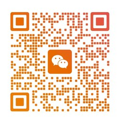
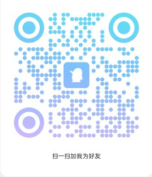

# Partner with us

> Part of the [LIS / LIMS Selection Guide](../README.md). Last reviewed 2026-11-18.

> **You own the market. We own the technology.**
> You handle customer relationships and regional delivery. We provide the product, solution design, implementation and technical support.

---

## Who this is for

- **EHR / EMR vendors** with no laboratory module, who keep losing bids because the lab component is missing
- **Instrument distributors and analyser agents** whose customers ask "which system comes with it?" at the point of sale
- **Regional health-IT integrators** who win hospital projects but need a LIS to complete the scope
- **Public-health programme implementers** needing a lab component inside a larger deployment
- **Individuals or small firms with laboratory relationships** but no product and no development team

If you are a laboratory looking to buy a system for your own use, the [main guide](../README.md) is the right place to start — this page is about partnership.

---

## What we commit to

These three matter more than any revenue-share number:

1. **We do not touch your registered customers.** Accounts you have reported are not quoted or signed directly. If a customer contacts us first, we pass the enquiry back to you.
2. **We carry delivery.** Solution design, deployment, training and incident response are ours. Your customer sees your team in front of them.
3. **You get usable material.** A demonstration environment, a quote template, competitive talking points, a compliance Q&A card, implementation SOP and a fault-handling runbook — things you can use in the next meeting, not a brochure.

---

## Four engagement models

| Model | Shape | Best for |
|---|---|---|
| **White-label / OEM** | We supply the product, you sell it under your own brand; we remain behind the scenes | EHR vendors, integrators who own the customer relationship |
| **Source-code licence** | Full source, database scripts and interface documentation, with agreed rebranding and redistribution rights | Partners with their own development team building a product line |
| **Project partnership** | A specific project with a defined scope and a revenue-share structure | One-off opportunities, resource-type introducers |
| **Regional reseller** | You represent the product in a defined territory, with a channel price and a customer-registration process | Distributors and regional service providers |

Commercial terms — pricing structure, project split and territory arrangements — are **discussed case by case**, based on project scale and the division of delivery work. We do not publish a rate card here because every deployment has a different interface, validation and localisation scope.

---

## Rules we work by

- **Customer registration and protection.** A simple registration process with an agreed protection period, so both sides know whose opportunity it is before anyone invests time.
- **Source code goes only to teams who can maintain it.** A source licence that turns into a failed implementation damages the customer and both brands. If your team cannot currently deploy and maintain the stack, white-label with us carrying delivery is the safer structure. We will say so plainly rather than sell you a licence.
- **Exclusivity is tied to performance.** Territory exclusivity is granted against an agreed volume and a review period, not indefinitely at the first conversation.
- **Three prices exist before any channel discussion** — end-customer, channel and floor. Otherwise the first quote becomes the anchor for every later negotiation.
- **Contract basics we will not skip:** deliverables inventory, acceptance criteria, interface count and unit price for additions, data-export and exit terms, support response hours and language, IP and rebranding scope, confidentiality, and who owns existing customers after termination.

---

## What we do **not** do

- We do not claim the software holds any certification. Accreditation attaches to laboratories; we provide the capabilities and records they need. See the [regulatory map](regulatory-map.md).
- We do not sell directly into a customer you have registered.
- We do not promise that buying a system will pass an accreditation assessment.
- We will not recommend open source where a commercial fit is wrong, or a commercial licence where open source is the better answer. The [open-source landscape](open-source-lis-landscape.md) is written in that spirit.

---

## How to start a conversation

**Preferred for overseas enquiries:** open a GitHub Issue or start a Discussion in this repository — asynchronous and time-zone friendly. Please do not post confidential institutional information in a public issue.

**For partners in China and APAC**, WeChat and QQ are fastest:

| WeChat | QQ |
|:---:|:---:|
|  |  |
| WeChat: **dynn2018** | QQ: **2536811576** |

Add "LIS" in the friend request. To make the first conversation useful, tell us three things:

1. What kind of organisation you are (EHR vendor / distributor / integrator / programme implementer / other)
2. How many laboratories or sites are in scope, and in which country
3. Where the opportunity currently stands (pre-RFP, tender issued, incumbent replacement, or just exploring)

With those three, we can tell you in one exchange whether there is a fit — and if there is not, we will say that too.
